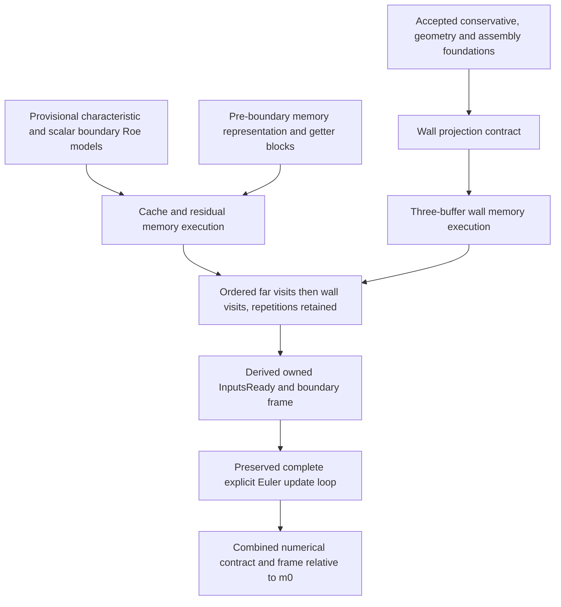

# Connected path coverage and next obligations

The missing boundary-to-memory transition is the new proved block. Earlier
candidates remain immutable and retain their external evaluation status.

| Stage | Current evidence | Remaining obligation |
|---|---|---|
| Conservative algebra, admissibility, oriented assembly | Preserved Lean proofs | Discharge physical callers and connect their storage |
| Preprocessing and primitive/current relationship | Explicit input relation only | Initialization, invalid-state fallback, old copy, primitive conversion and storage |
| Interior first-order SIMD Roe | Supplied interior residual data | Independent Roe specification, all lanes/branches, source computation, scratch state |
| Edge/geometry traversal | Supplied metadata/lists and proven model bounds | Actual mesh enumeration, ownership, normals, volumes, unique and repeated indices |
| Boundary scalar characteristic/Roe arithmetic | Preserved closed exact-real implementation model and provisional spec refinement | Agent A literature review; rigorous C++ translation |
| Boundary memory transition | New checked loads/stores, cache layout/frame, ordered folds and source fragments | C++ pointers, object layout, selected caller enumeration and scratch lifetime |
| Update getter values | Actual abstract getter loads; boundary preservation proved | Source volume/periodic/dt initialization and timestep computation |
| Complete explicit update | Preserved loop proof applied with readiness derived here | Concrete C++ traversal/layout/compiler bridge and finite arithmetic |
| Whole Euler execution | Partial connected path only | All remaining stages above; no whole-path acceptance |

The initial residual is deliberately a pre-boundary input. The preserved
`masked_assembly_correct` can rewrite a caller-provided scatter-loop state into
oriented assembled contributions before applying this theorem. It does not yet
establish an actual interior-loop memory transition, so that bridge remains open.

Next sequence:

1. Complete independent evaluation of the previous and new frozen identities.
2. Obtain approved, pinned CFDLean characteristic/far-field and Roe requirements;
   prove compatibility or report discrepancies without rewriting those contracts.
3. Refine preprocessing, primitive and old-solution initialization, and timestep
   storage. Tie the boundary visit sequence and ownership flags to the actual
   integration caller and geometry containers.
4. Connect first-order SIMD Roe arithmetic, scratch values and residual scatter to
   memory for every selected edge/lane, composing the existing assembly theorem.
5. Close concrete C++ memory and control semantics, then floating-point/library and
   compiler obligations under a stated arithmetic model.

Unsupported configurations remain explicit: 3D, moving/deforming grids, MPI,
OpenMP, periodic boundaries, viscous/Navier–Stokes/RANS, implicit or Runge–Kutta
updates, nonideal gases, higher-order reconstruction, entropy-fix settings other
than the selected case, multigrid paths, adaptation and unselected boundary types.
