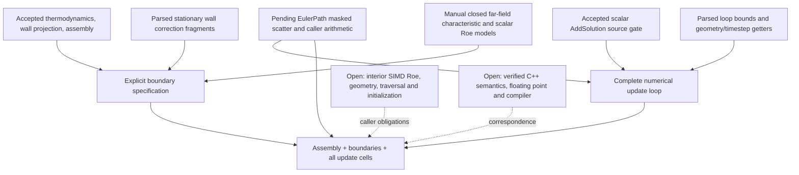

# Path coverage and next obligations

| Stage | This candidate's coverage | Remaining production obligation |
|---|---|---|
| Conservative/primitive gas algebra | Previously accepted, unchanged | Primitive-buffer preprocessing and finite evaluation |
| Old-state copy, residual/truncation initialization | Explicit input relation; old is post-boundary, current initially arbitrary | Actual allocation/zeroing/copy, preprocessing order, all frames |
| Timestep and volume | Actual getter text parsed; load identities and nonperiodic zero premise explicit | Positivity and real decoding from geometry/timestep computation; periodic initialization |
| Interior SIMD Roe | Previously supplied flux values | First-order Roe lane arithmetic/eigensystem, entropy branches, SIMD masks, finite values |
| Mesh/edge iteration | Preserved masked scatter and signed-assembly proof | Actual connectivity, edge traversal coverage, orientations, area normals, padding bounds |
| Far-field | Closed characteristic/cache/flux transformation; reconstruction, geometry, admissibility and dissipation-loop proofs | Full routine translation, scalar-Roe eigenmatrix correspondence, actual primitive/cache objects and vertex traversal |
| Stationary Euler wall | Three source-gated projections, frames, admissibility and post-update impermeability | Actual branch/ownership/normal selection and boundary vertex traversal |
| Explicit update | Entire owned-point/four-component model; getter loads, bounds, no duplicates, coverage, frame, old/current relationship | Certified linking of parsed fragments into actual C++ body; object representation and residual monitoring |
| End-of-step communication/diagnostics | Actual selected native method exercised | Formal selected no-MPI behavior and diagnostics frames |
| Floating point | Native double comparisons only | IEEE-754, pow/sqrt, fast-math effects, exceptions, rounding, stability and positivity |

## Expansion sequence

1. Freeze and independently cold-evaluate this candidate; resolve evaluator findings
   in a new identity rather than altering any pending frozen candidate.
2. Establish the real C++ buffer representation and allocation/initialization/copy
   contract. Prove primitive preprocessing and the actual residual/truncation origins.
3. Connect boundary vertex and edge lists, ownership and normal construction to the
   mathematical lists. Establish caller preconditions for each proved block.
4. Refine the actual first-order SIMD Roe implementation, including its selected
   eigensystem, entropy fix, masks and zero/invalid-state branches. Reuse local
   dissipation/assembly proofs only where semantics match.
5. Prove timestep computation and positive volume for the selected geometry; compose
   initialization, Roe, traversal, boundaries and all updates into a closed exact-real path.
6. Choose and qualify a semantic C++ frontend/translation validation mechanism and
   memory model. Then add floating-point error/domain analysis and compiler assumptions.
7. Only after this path closes, qualify new configurations in separate gates: 3D,
   unsteady/implicit integration, Navier–Stokes, RANS, MPI and mesh adaptation.

This is not complete execution-path verification or whole-solver verification.
