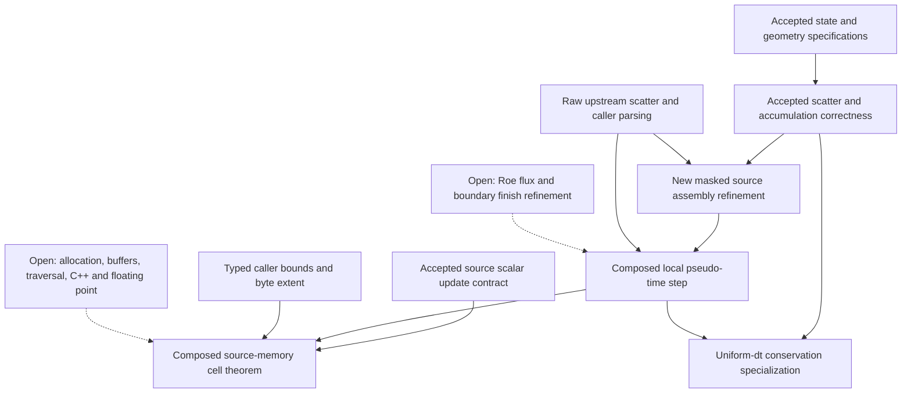

# Selected production path and composition dependencies

Pin: `su2code/SU2` develop `d162016382f0c122433000c114e88d808b48f7a7`.
Line references below name this immutable source; `source-manifest.json` records selected
complete-file hashes and exact byte spans. The test configuration is checked in at
`tests/integration/euler.cfg` with its 20-node, 24-triangle fixed rectangular mesh.

## Dispatch

The build is C++17, LP64 passive double, CPU, no MPI/OpenMP/CUDA/AD, release with
upstream `-O3 -ffast-math -fno-finite-math-only`. No production edits. Native source-slice
controls separately use `-O2 -DNDEBUG` without fast-math; their results do not prove
release-compiler equivalence.

The case selects 2D `EULER`, `DIRECT`, steady pseudo-time, `STANDARD_AIR` (ideal gas),
`ROE`, `ROE_KAPPA=0.5`, `ENTROPY_FIX_COEFF=0`, `MUSCL_FLOW=NO`, no slope limiter,
`LOW_MACH_CORR=NO`, `LOW_MACH_PREC=NO`, `EULER_EXPLICIT`, `CFL=0.1`, no adaptive CFL,
`MGLEVEL=0`, one pre-smooth, no post/correction smooth, no early-exit smoothing,
`GRID_MOVEMENT=NONE`. Boundaries are only flat upper/lower `EULER_WALL` and `FAR_FIELD`.
No periodic/interface, source, axisymmetric, rotation, turbulence, species, Newton,
adjoint, restart, dual-time or mesh-adaptation path is selected.

`CSolverFactory::CreateSolver` assigns the flow solver the MULTIGRID integration class
when Newton-Krylov is off, even when `MGLEVEL=0`. `CFluidIteration::Iterate` calls
`MultiGrid_Iteration`; `MultiGrid_Cycle`/`PreSmoothing` execute the one fine-grid step.
No coarse-grid transfer occurs. Do not substitute `CSingleGridIntegration` as the actual
flow dispatch merely because this case has one level.

`CEulerSolver::Upwind_Residual` (1826) sees ideal gas, no low-Mach correction and Roe,
then calls `EdgeFluxResidual` and returns. The legacy scalar Roe residual is not executed.
`USE_VECTORIZATION=NO` would not select it: the template documentation says supported
schemes always vectorize. With no `HAVE_OMP`, `ReducerStrategy=false` in
`CFVMFlowSolverBase.hpp` (208): `UpdateType::COLORING` is used. `Double::Size` depends on
compile-time SIMD; this host's actual width is recorded by the native control. The
formal list model is independent of width; correspondence of batches to that list is open.

## Coverage map

| Production node | Coverage and remaining obligation |
|---|---|
| Driver/config factories → CFluidIteration → CMultiGridIntegration | **native tested only** and manually inspected dispatch; no formal CConfig semantics. |
| Preprocessing, CVariable::Set_OldSolution, primitive state | **specification proved** for accepted ideal-gas conversion; allocation, copy, recovery/fallback branches and C++ fluid-model correspondence **not yet covered**. |
| Fixed mesh, physical/control volumes, edge endpoints and normals | **specification proved** for typed geometry; mesh loading, orientation, normalization and traversal coverage **not yet covered**. |
| CEulerSolver::SetTime_Step → local pseudo-time | **native tested only**; dt positivity/CFL/stability **not yet covered**. |
| EdgeFluxResidual → CNumericsSIMD::CreateNumerics → CRoeScheme<CNoViscousFlux<2>>::ComputeFlux/finalizeFlux | **native tested only**; first-order Roe flux consistency/eigensystem/entropy correction **not yet covered**. Input flux is explicit in the theorem. |
| EdgeFluxResidual mask construction and coloring call; util.hpp updateLinearSystem COLORING arm | Manual source connection; finite-list/batch enumeration and guard/runtime dispatch proofs **not yet covered**. No REDUCTION or implicit matrix operation is claimed. |
| CSysVector::UnpackBlock | Raw source recorded, multiplication modeled, **native tested only** for C++ connection; helper translation/array layout remains manual. |
| Actual SIMD CSysVector::UpdateBlocks (682) | **restricted implementation model proved**; **production-source connection established with stated assumptions** through raw-text kernel parsing, exact source identity, manual semantics and native controls. This label does not mean certified C++ semantics. |
| CIntegration::Space_Integration → no-op inviscid viscosity, source slots, weak far-field then final Euler-wall projection | **native tested only**; supplied `finish` interface, old-state and truncation transformations **not yet covered**. The wall changes Solution_Old: theorem inputs mean post-boundary buffers. |
| CIntegration::Time_Integration → CEulerSolver::ExplicitEuler_Iteration (2512) → Explicit_Iteration<EULER_EXPLICIT> | Manual call-chain inspection plus native full run. Actual explicit path identified afresh. |
| CFVMFlowSolverBase.hpp Identity::apply, physical+periodic volume, Delta, explicit switch arm (853–954) | **restricted implementation model proved** and **production-source connection established with stated assumptions** for extracted fragments; the complete enclosing loop, getters, runtime branch invariants and memory remain open. |
| Scalar CVariable::AddSolution | Fresh raw source is exactly the accepted method. Universal accepted contract and refactor proof reused; modeled caller address preconditions proved. Actual C++ accessor/heap/compilation refinement remains open. |
| Communication, monitoring, postprocessing | **native tested only** in serial/no periodic case; no MPI proof. |

## Proof dependency graph

## Expansion order

1. Prove initialization/copy, component enumeration and whole-update-loop frame invariant;
   connect physical volume and zero periodic volume to the runtime geometry.
2. Replace `finish` with a verified joint transformer for flat stationary Euler walls,
   far-field contributions, `Solution_Old` and truncation storage, preserving actual order.
3. Prove edge enumeration and masked batch flattening against the fixed mesh, including
   padded lanes and orientation; connect unpacking/storage to a checked memory model.
4. Specify first-order ideal-gas Roe flux, prove consistency and orientation behavior,
   then connect the actual SIMD flux source and its entropy/fallback branches.
5. Compose initialization → full residual → boundary → update with explicit admissibility
   or CFL obligations. Only then claim a configured Euler residual/update result.
6. Add floating-point semantics/error analysis separately. Extend dimensions, spatial
   order, moving grids (reviewed wall repair), multigrid, viscous/RANS, implicit solve,
   MPI and adaptation by explicit contracts; never inherit coverage automatically.
