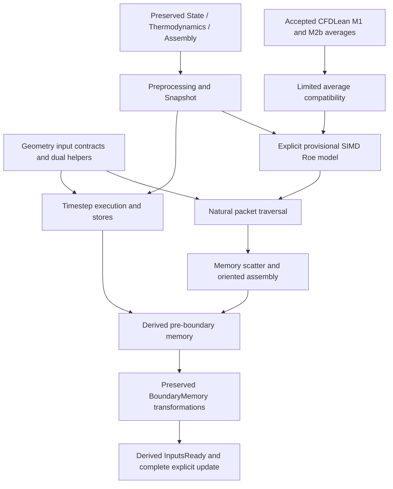

# Connected path coverage

| Stage | Mathematical / formal implementation result | Remaining production obligation |
|---|---|---|
| Conservative seed, old copies | Preserved conversion, constructor projection and snapshot proofs | Freestream nondimensionalization, complete C++ setup/allocation |
| Primitive conversion/fallback and preprocessing | Preserved point/loop/source-gate proof; all allocated rows and zero residual | IEEE acceptance/cancellation/NaN; independent cold parent acceptance |
| CFL initialization | Executed all-point scalar stores and frame | Full initialization caller and auxiliary solver metadata |
| Node-centered geometry | Oriented dual helpers, nonnegative/conditional positive volume, repair, typed endpoints | Actual mesh parsing, complete SetEdges/incidence/ownership/volume construction, EPS floating-point behavior |
| Timestep | Neighbor/boundary spectral accumulation, zero-volume branch, raw diagnostics/cap, actual store retrieval and frames | Getter/heap/compiler/FP interpretation; unsupported moving/viscous/unsteady branches |
| Serial edge traversal | Natural edge list coverage/order/uniqueness; positive-width packets and active/inactive lane behavior | C++ coloring/object decoding; MPI/OpenMP strategies; full setup of counters/numerics |
| Interior SIMD arithmetic | Explicit six-field reads, source ratio averages/tensors/flux; equal-state physical consistency | Independent full Roe flux/eigenbasis/dissipation compatibility; C++/SIMD arithmetic semantics |
| Independent CFDLean | M1 embedding and accepted M2b velocity/enthalpy/sound compatibility, sound positivity | Complete M2 Roe and boundary literature approval; remaining convention compatibility |
| Interior accumulation | Actual component-interleaved model → oriented assembly, all-allocated conservation, buffer/cache frame | Safe actual vector accesses, integer/alias/pointer/compiler/concurrency semantics |
| Interstitial source/interface stages | Explicit selected inactive guards; source bodies/config/native trace | Heap scratch/table loads; nonselected sources/interfaces unsupported |
| Boundary-to-memory | Preserved explicit far/cache/wall memory execution and readiness derivation | Provisional far/Roe mathematics; independent cold/native acceptance; heap/FP |
| Complete explicit update | Preserved complete loop theorem, newly computed dt/residual consumed | Actual getters/memory/FP/compiler correspondence |
| Composition | First-iteration preprocessing → timestep → interior → boundary → full update, frame from initial memory | All above gaps; not a complete C++ Euler execution path |
| Robustness | Exact-real old admissibility invariant and old-memory update frame; native reachability probes | Floating-point invariant/reachability, adversarial meaningful meshes/states; no confirmed fallback defect |

Dependency structure:

Proposed next milestone: prove mesh-to-typed-geometry construction and primitive/scratch gather safety for the selected serial triangle fixture and then generalize the contracts; integrate independently approved full CFDLean Roe eigenbasis/dissipation/flux through convention-specific refinement theorems. Separately connect complete initialization/nondimensionalization and initial zero truncation/counters to the current initial representations. Keep arithmetic, heap and compiler obligations explicit until supported by an adequate correspondence mechanism. Parallel strategies are later milestones.
