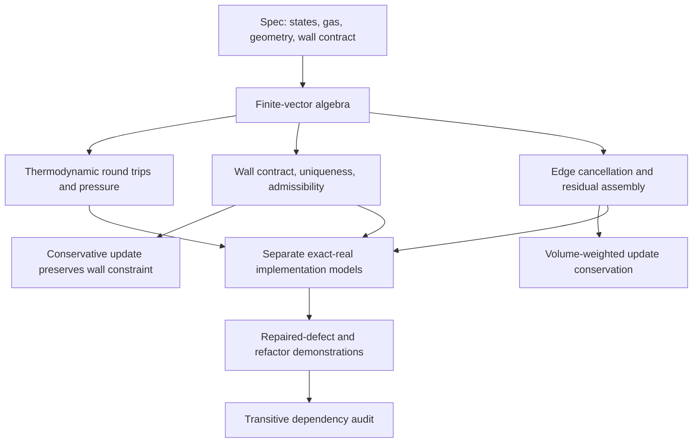

# Proof composition and Euler expansion

The generic finite dimension, typed conservative channels, arbitrary initial residual,
and unconstrained increment type permit composition without restricting increments to
physical states. Geometry enters through explicit unit-normal and positive-volume
contracts. Theorems about isolated algebra do not discharge these contracts at SU2 call
sites. See the independent evaluator's required obligations below.

1. Freeze and independently approve Phase 1 specifications. Recheck every proof and source
   mapping, especially sign conventions and the old/current state distinction.
2. Add a scalar, first-order, ideal-gas Euler numerical flux (choose and pin one production
   scheme). Prove physical-flux consistency, orientation symmetry, and its admissibility
   requirements. Include every branch of that scheme, not just a contact or acoustic case.
3. Connect source layouts, bounds, pointer ownership and sequential loop semantics to
   verified models. Select a frontend/certificate approach; keep unverified translation
   explicit. Establish floating-point error/exception contracts separately.
4. Prove mesh normal orientation, positive dual volumes, ownership and complete face
   traversal. Then connect fluxes to the existing assembly theorem.
5. Add far-field/inlet/outlet and wall contributions with a complete boundary budget.
   Prove residual plus source assembly for a bounded serial Euler configuration.
6. Formalize explicit step/stage ordering, saved-state updates, timestep restrictions,
   invalid-state recovery and positivity control. Compose a complete Euler residual/update
   path, first static then ALE with geometric conservation and moving wall velocity data.
7. Add MUSCL reconstruction/limiters, multiple wall normals, multigrid transfers and
   implicit linear solve contracts. Approximate Jacobians must be specified as such.
8. Add MPI ownership/halo exchange, OpenMP race freedom and reduction error semantics;
   replace serial exact-real order invariance by appropriate machine-arithmetic claims.
9. Extend thermodynamics and flux budgets to viscosity, heat transport and Navier–Stokes;
   then RANS with explicit rho*k/total-energy conventions and turbulence positivity.
10. Extend to adaptation: conservative transfer, geometry validity, history fields, boundary
    constraints, and solver/restart state consistency across a mesh change.

Steps 2–6 form the next complete Euler milestone. Later steps are interfaces and proposed
obligations, not existing proofs or claims of support.
