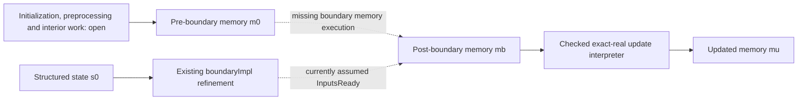

# Boundary-to-memory gap: pinned-source investigation

Status: source reading and proof-design investigation, not a new formal verification
milestone. Production baseline: `d162016382f0c122433000c114e88d808b48f7a7`.
Frozen Lean candidate: `73a322b640f45505e8d8fb70fbce46e6ccffd206`.
The exact source files and line ranges below are recorded in `source-evidence.json`.

| Item | Verdict | Evidence | Branch / fix | Validation |
|---|---|---|---|---|
| Provisional external decision | RECORDED, not final acceptance | Original evaluator record and matching archive/lock identities | `formal/lean-boundary-review`; no fix | Report hashes and nine externally reported native fragment outcomes |
| Post-boundary memory premise | BY READING; proof gap confirmed in statement | `Loop.lean:235` and `:248`, ready premise | Investigation only | Existing theorem statement, not a newly failed proof |
| Missing scalar-store interpretation of boundary transforms | BY READING | `Boundary.lean:29`, `:187`, `:209` modify structured values | Proposed new module after the pending gates | No new Lean theorem claimed |
| Cache layout and untouched fields | BY READING | `CEulerSolver.cpp:121`, `:5189`; `CFVMFlowSolverBase.hpp:2132` | Future representation/frame proof | Actual 11-column allocation; six selected stores |
| Initialization and invalid-state fallback | BY READING | `PreSmoothing`, `CommonPreprocessing`, `CEulerVariable::SetPrimVar` | Future caller proof | Branches traced, not executed anew |
| Lost boundary writes / recomputed projection scalar | EXACT-RATIONAL DIAGNOSTICS ONLY | `diagnostic.json` | Future semantic controls | Checked rational arithmetic; no SU2 defect inferred |
| New production defect | NONE CONFIRMED | No production patch proposed | None | Existing mutations remain controls, not discovered defects |

## 1. Exact gap and entry point

`SU2Source.Memory R` is an address-to-optional-scalar map. The checked update
interpreter uses actual loads and stores in that model. By contrast, `wallImpl`,
`farImpl` and `boundaryImpl` transform a `BoundaryState` value. They do not execute
boundary memory reads and writes in `Memory R`.

The frozen theorem requires:

```text
InputsReady m
  (boundaryImpl g free far walls
    {s with residual := scatterLoop originalScatter lanes s.residual})
  vol (fun _ => 0) dt
```

That premise is explicit, legitimate for the stated intermediate theorem, and
not established by the theorem's execution. Its conclusion runs `executeLoop` on
m. Rewriting a structured-state equality cannot itself create a memory transition.

The smallest next entry point is the start of the selected weak-boundary phase,
after interior/source residual work. Use an incoming state s0 and memory m0 related
*before* boundary processing. Their residual may be arbitrary initialized data.
Do not quietly claim its origin from interior SIMD Roe or residual assembly has
been proved. The existing scatter theorem is also a value-level result; connecting
an initial pre-assembly memory to this boundary-entry memory is a separate obligation.

## 2. Selected caller order and actual storage effects

The pinned flow factory selects `CMultiGridIntegration` for direct Euler with
Newton disabled, even when `MGLEVEL=0`. The configuration defaults Newton to false;
this selection has no new verified-dispatch proof. `CFluidIteration` calls
`MultiGrid_Iteration`, then `MultiGrid_Cycle` invokes `PreSmoothing`.
The pinned configuration requests one presmoothing step and no coarse levels.
`PreSmoothing` orders these operations:

1. Preprocessing: primitive reconstruction, including invalid-state fallback,
   then residual initialization for the selected no-OpenMP/non-reducer path.
2. At RK step zero, copy current to old, then compute timestep.
3. `Space_Integration`: interior flux, viscous/source interfaces and any applicable
   auxiliary work, then weak boundary markers, then final symmetry/Euler walls.
4. `Time_Integration`: dispatch to `CEulerSolver::ExplicitEuler_Iteration`, which
   instantiates `Explicit_Iteration<EULER_EXPLICIT>` and its Identity preconditioner.

Excluded/default auxiliary branches and their frames are caller obligations. In
particular, the source calls viscous/source/fluid-interface methods in the outer
routine; full configured no-op/dispatch correspondence is not proved here.
The new local boundary proof should begin after those calls, not silently erase them.

| Selected operation | Loads and stores to model | Preserved persistent data / requirements |
|---|---|---|
| Far-field visit | Get marker/vertex cache pointer, check ownership, load primitive point snapshot, construct six cache values, borrow primitive/cache pointers for scalar Roe, AddBlock into residual | Old, truncation, current, primitive, volume/dt; other cache fields. Cache lookup precedes ownership test, so even skipped visits need valid pointer metadata in a C++ interpretation. |
| Stationary wall visit | Check ownership; select geometry/symmetry-adjusted normal; read two old momentum values and compute full dot product, then two stores; repeat for residual, then truncation | Density/energy in all three buffers; current/cache/primitive/geometry/timestep. Stationary branch adds no boundary energy flux. |
| Complete explicit update | Read post-boundary old, residual, truncation and geometry/timestep getters; store each of four current components at each owned point | Existing `LoopContract` frames other modeled addresses relative to post-boundary memory. Diagnostics, communication and numerics-object state are outside this contract. |

The pointer getters bind old to `Solution_Old[iPoint]`, truncation to
`Res_TruncError[iPoint]`, and residual to `vec_val[iPoint*nVar]`.
`CSysVector::AddBlock` calls `SetBlock<VectorType,false>`, which adds each component
with alpha=1. The explicit Euler preconditioner is residual+truncation, and
`AddSolution` uses old as its base. These binding/linking facts are currently manual
source connections; their bodies must participate in the future memory refinement.

Repeated visits cannot be deduplicated. Accumulation and projections must read the
memory produced by the previous visit. Retain marker order and vertex order, including
points shared by far-field and wall markers. Modified `symmetryNormals` may replace
raw normalized vertex normals; constructing these normals and the visit lists remains
unproved. Arbitrary incompatible wall normals do not imply simultaneous impermeability.

## 3. Representation requirements exposed by the source

The existing block numbers are 0=current, 1=old, 2=volume, 3=periodic volume,
4=timestep, 5=residual, 6=truncation, 7=LocalCFL. Reuse these identities and
`Memory`, address/bound lemmas, `projection_correct`, `wall_source_contract`,
`far_source_call_contract`, `boundary_refinement`, and `complete_update_loop`.
There is no need to rewrite the protected foundations or invent another general IR.

Extend the representation only for inputs/outputs that the selected boundary reads
or writes. Prove bounds and disjointness for primitive and per-marker cache views;
keep six exposed fields distinct from the full physical row layout:

| Quantity | Pinned 2D layout | Obligation |
|---|---|---|
| Conservative arrays and residual/truncation | Four components per point | Preserve existing offsets and allocation bounds |
| Primitive point rows | `nPrimVar=nDim+9=11` columns | Selected loads use velocity, pressure, density and stored enthalpy; primitive preprocessing and current-state agreement remain explicit |
| Characteristic cache | One row-major matrix per marker, vertex row, 11 columns | Far-field writes columns 0..5: T, vx, vy, p, rho, H; frame columns 6..10 and all other rows |
| `BoundaryState.cache : Nat -> Option Ghost` | Abstract key and six meaningful fields | Establish an injective mapping of marker/vertex identities, not point identity alone; specify meaning of absent/partially initialized cache entries |

A six-column memory stride would misrepresent this source. Two different boundary
vertices may reference the same point while owning distinct cache rows. `AllocVectorOfMatrices`
initializes the allocated matrices to zero, but this is a source fact requiring an
allocation/initialization proof, not permission to assume every input cache is a
physically admissible ghost state. The current native fixture checks only its six
exposed cache fields; a future frame test should also seed and check columns 6..10.

`SetPrimitive` and `SetNormal` in `CNumerics` retain pointers. The returned
`ResidualType` is a view of internally stored flux. AddBlock consumes it before the
next residual computation. A source-semantic proof must justify these lifetimes,
read-before-overwrite order and non-aliasing. Scratch arrays and numerics-object fields
also change; a frame over the selected logical buffers is not a frame over the
entire C++ heap. Modeling the full heap would require a larger footprint.

For every wall buffer, calculate the entire reduction before the first momentum
store. Recomputing the scalar using partially corrected momentum is a different
algorithm. For a skipped visit, retain the actual ownership branch without assuming
all cache/pointer metadata was never accessed. The present `Fin N` boundary lists
still do not cover arbitrary MPI halo indices outside the owned prefix.

## 4. Proposed memory proof and composition

The following is design notation, not an implemented Lean statement or accepted
specification amendment:

```text
BoundaryEntryReady(m0, s0, inputViews, visitMetadata, vol, 0, dt)
AND explicit bounds / input-domain hypotheses
IMPLIES there exist mb and mu such that
  execBoundary(selectedCode, inputViews, visitMetadata, m0) = some mb
  AND BoundaryRep(mb, boundaryImpl(g, free, far, walls, s0))
  AND InputsReady(mb, boundaryImpl(g, free, far, walls, s0), vol, 0, dt)
  AND executeLoop(selectedExplicitCode, mb) = some mu
  AND LoopContract(boundarySpec(g, free, far, walls, s0), vol, dt, mb, mu)
  AND CombinedFrame(m0, mu, boundaryWrites UNION currentUpdateWrites).
```

`BoundaryEntryReady` may constrain initialized incoming reads, allocated views,
input primitive snapshots and geometry. It must mention s0, not assume the calculated
post-boundary buffers. Cache representation must document what `None` means and
must not infer initialization for unwritten cells. `FarReady` remains an explicit
numeric/preprocessing premise until its caller proof is supplied.

`execBoundary` must load from m0 and perform the selected ordered stores; it cannot
just calculate `boundarySpec s0` and encode that result into memory. It should not
receive the expected post-state as an input. Keep failure for missing required loads
or invalid views. The existing closed characteristic/Roe implementation model may
be reused provisionally, with its manual-source and literature-status qualifications;
there must be no new unconstrained boundary-flux callback.

Prove one-buffer projection execution and frame first, then three-buffer wall
execution. Prove cache stores, scalar-Roe input reads and component residual
accumulation for one far-field visit. Lift both results through the actual ordered
lists using the evolving memory, and derive `InputsReady` from this transition.
Apply the existing `complete_update_loop` to mb. This is actual composition of the
proposed memory transitions, still subject to the separately stated C++ interpretation.

**Frame distinction:** the old `LoopContract` cannot be applied with m0 as its
pre-state for the entire boundary-plus-update path: it would forbid the boundary's
legitimate old/residual/truncation/cache changes. Keep its pre-state mb. Prove a
separate combined frame over m0 and mu, outside the union of the real write sets.
Volume, periodic volume, timestep, primitive data and untouched cache/halo cells
must be retained. Normal, cache and primitive getters need their own bounds; the
four-component update bound alone does not prove an 11-column cache bound.



## 5. Concrete diagnostics and future controls

An exact-rational witness illustrates the lost-write problem. Choose unit normal
(3/5,4/5), old momentum (3,4), residual momentum (5,12), truncation momentum (1,0)
and dt/volume=1/10. Project all three buffers before updating. The resulting momentum
is (24/125,-18/125), with zero normal component. Discard the boundary memory result
and update from the unprojected buffers instead: momentum is (12/5,14/5), with normal
component 92/25. These values were checked with exact rational arithmetic.

A second diagnostic recomputes the old-buffer projection scalar after the first
store. It produces (0,36/25) instead of (0,0). Both are proposed *future* semantic
mutation experiments, not found production defects and not new formal proofs.

Retain all existing controls. The next unchanged approved memory contract should
also distinguish: using m0 instead of mb; wrong target buffer; ignoring truncation;
incorrect 6-column cache stride or marker/vertex collision; overwriting untouched
cache columns; stale reads across repeated visits; and recomputing the projection
scalar between stores. Missing-read/bounds rejection is a separate execution failure
control, not semantic numerical defect detection. Add a benign refactor control
that preserves read/store order and proves the same memory contract.

## 6. Initialization, scientific approval and remaining scope

`CommonPreprocessing` zeroes residual on the selected non-reducer path; the
no-OpenMP class fixes `ReducerStrategy=false`. `CVariable::Set_OldSolution` copies
current to old after preprocessing in `PreSmoothing`. `CFlowVariable` initializes
truncation and timestep arrays; `CPoint` initializes periodic volume to zero.
The actual timestep computation, positive volumes and complete lifetime of these
values remain unproved.

`CEulerVariable::SetPrimVar` may overwrite invalid current conservative data with
old data and recompute primitives. An initialization proof must retain this branch,
or explicitly prove its guard false from independently justified input assumptions.
It cannot simply assume current never changes before the old copy. Constructor zeros
alone do not establish an admissible state or a positive timestep, and preservation
of zero truncation/periodic values across the full selected execution remains a caller task.

The evaluator labels the new far-field/Roe definitions provisional SU2-specific
specifications pending literature approval. Preserve their frozen text and record
this qualification externally. No approved CFD_Lean revision has been supplied in
this review; none is imported. Future comparison must distinguish agreement,
intentional variant, potential defect, method limitation and unresolved correspondence.
No literature-derived correctness claim follows from this source investigation.

Independent cold acceptance, interior SIMD Roe, edge/vertex and normal construction,
initialization, full source-language heap/dispatch semantics and floating-point/compiler
behavior all remain open. This investigation does not close any of them by declaration.
