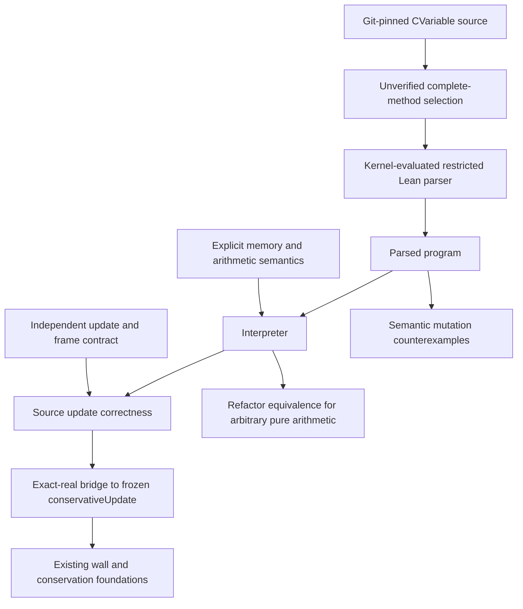

# Source-connected scalar update gate

This candidate continues the [accepted Phase 1 foundations](../Acceptance/README.md).
It feeds the complete, pinned scalar `CVariable::AddSolution` method text into a Lean
parser and proves its behavior in an explicit restricted language. The source text,
parser, operational semantics and mathematical contract are separate artifacts.

**Status: checked locally, pending a new independent evaluation.** Production C++ semantics
and IEEE-754 numerical correctness remain open. Neither production code nor the accepted
Phase 1 statements were changed.

- [Specification and assumptions](SPECIFICATION.md)
- [Source connection, coverage and remaining obligations](CORRESPONDENCE.md)
- [Reproduction and independent evaluation](REPRODUCE.md)
- [Worker check results](evidence/result.json)
- `candidate.json`: exact candidate files and explicit theorem inventory to freeze externally.

## Composition

The next useful extension is to discharge the accessor/layout correspondence and define
machine addition, then cover the caller's multiplication and ordered component loop.
The existing [Euler expansion sequence](../Lean/docs/DEPENDENCIES.md) remains the larger
plan: numerical flux, geometry/ownership, residual assembly, boundaries, timestep/stages,
then a complete bounded serial Euler path before broader solver configurations.
