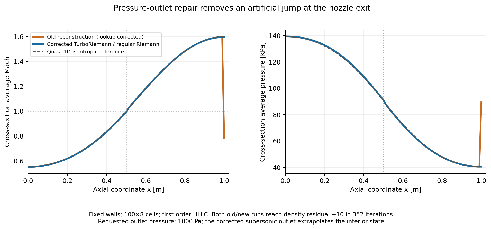

These checks exercise TurboRiemann pressure outlets on fixed-wall converging-diverging nozzles. They use the same 100×8 mesh as the earlier ordinary Riemann checks, first-order HLLC, implicit FGMRES/ILU, CFL 20, and two MPI ranks. The outlet target is 1000 Pa. Both flows eventually become supersonic at the exit, so the final outlet pressure must be extrapolated.

Three problems were reproduced: a Riemann marker was looked up in the Giles configuration, the linear characteristic projection could give a nonphysical real-gas outlet state, and the implicit moving-grid residual subtracted the grid flux twice. The pressure reconstruction now shares the regular Riemann helper. A radial-equilibrium outlet supplies its existing spanwise pressure profile to that helper; this does not change how the profile is calculated. Other TurboRiemann modes retain their existing reconstruction and receive only the correction to the configuration lookup and the duplicate grid-flux subtraction.

The original binary crashes before writing history in the MDM case. The `before` binary corrects only the marker lookup, so the old pressure projection can be compared. Apply `lookup_only.patch` to commit `16fed53a958c044654052e9e7ede22168dcbae08` to reproduce that variant. That version produces NaN at startup for MDM. The repaired TurboRiemann and regular Riemann MDM runs both reach log10 RMS density residual −7 in 429 iterations. The deliberately moderate threshold avoids the separate reservoir-inlet EOS precision issue; this test does not claim convergence to −10 for that setup.

For air, the lookup-only and repaired versions both reach density residual −10 in 352 iterations. The old outlet row has Mach 0.786 and pressure 89.59 kPa, despite supersonic flow immediately upstream. The repaired row has Mach 1.594 and pressure 40.47 kPa, removing that artificial jump. The interior flow is already choked in both runs. Corrected TurboRiemann and regular Riemann fields agree to roundoff. The quasi-one-dimensional curve is a useful approximate reference, not an exact solution for this two-dimensional mesh.

Each directory contains its configuration, mesh, solver log and result record; successful runs also have a history and field file. `summary.json` collects the records, including binary hashes. Run `python3 run_cases.py --binary /absolute/path/to/SU2_CFD MDM_nozzle_after MDM_nozzle_regular air_nozzle_after air_nozzle_regular`. Use `--ranks` and `--threads` to select parallelism. `plot_air_nozzle.py` checks agreement with the regular Riemann control and generates the plot.

Unit tests separately cover static and radial-equilibrium targets, two and three dimensions, ideal gas/Peng–Robinson/van der Waals, subsonic reverse and outward flow, the sonic limit, moving grids, finite-difference boundary Jacobians, and frozen SST kinetic energy. The SST fixture suppresses diffusion to check the convective map; it is not a complete viscous turbomachinery validation. Giles, mixing-plane reconstruction and ordinary real-gas outlet support are outside this change.
